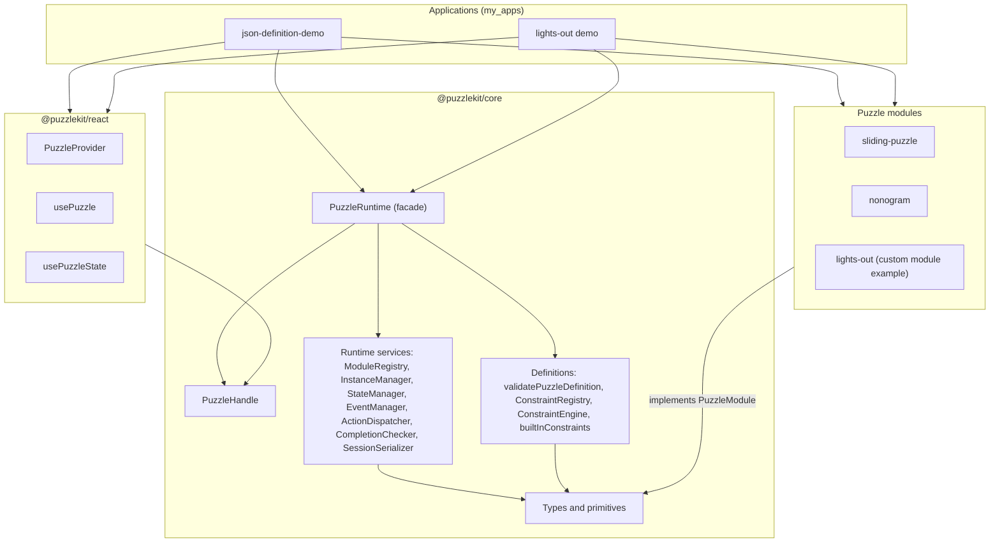
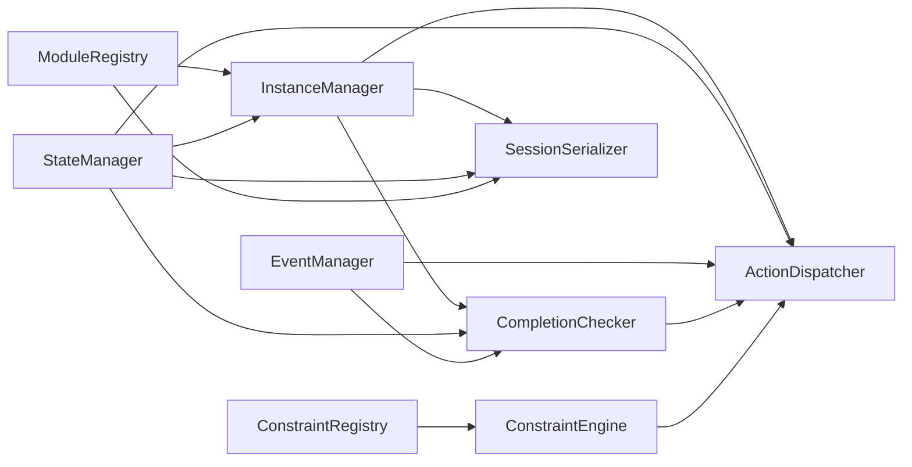
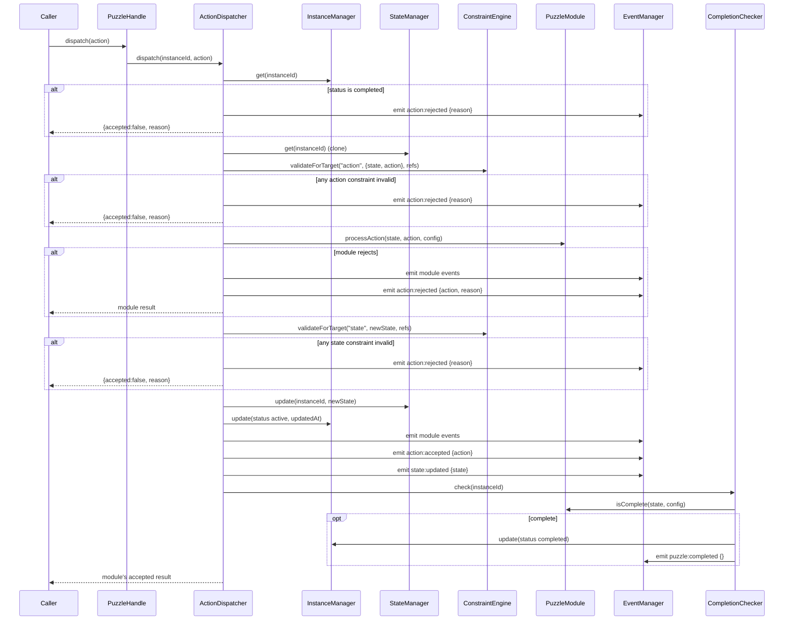
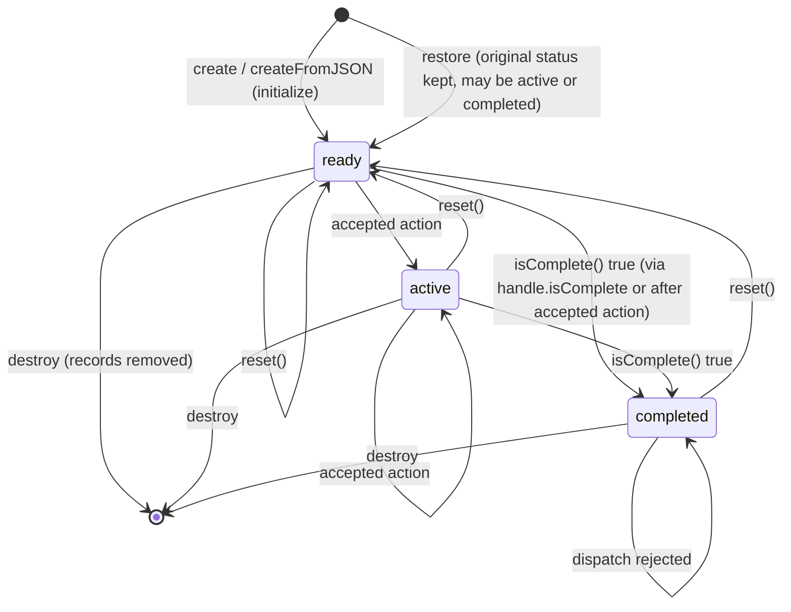

# Design Document

## Overview

PuzzleKit is a TypeScript npm-workspaces monorepo with three layers:

- `@puzzlekit/core` (`packages/core/src`): a framework-independent runtime that hosts pluggable puzzle modules. It contains the runtime classes, the definition and constraint subsystem, shared types, and primitives.
- Puzzle modules (`packages/modules/sliding-puzzle`, `packages/modules/nonogram`): plain objects implementing the `PuzzleModule` contract. A third module, Lights Out, serves as the reference example of a custom module.
- `@puzzlekit/react` (`packages/react/src`): a thin adapter with `PuzzleProvider`, `usePuzzle`, and `usePuzzleState`.

Key design characteristics:

- Modules are pure state transformers. They never touch the runtime, events, or status.
- The runtime owns all orchestration: instance bookkeeping, constraints, event emission, completion, and sessions.
- All collaborators are constructed in `PuzzleRuntime` by field initializers and passed to each other through constructors. There is no dependency injection container.
- State is stored and returned as `structuredClone` copies, so callers and modules cannot alias stored state.
- Everything is synchronous. Errors are thrown as plain `Error` with fixed messages. Rejected actions are returned as values.

## Architecture

### Layered architecture



Dependency direction: modules and the React adapter depend on `@puzzlekit/core` types and the `PuzzleHandle` class. Core never imports from modules or React. Modules are connected to the runtime only at run time through `registerModule`.

### Runtime composition

`PuzzleRuntime` constructs these collaborators in declaration order:



`PuzzleHandle` instances receive references to `InstanceManager`, `StateManager`, `ActionDispatcher`, `EventManager`, `CompletionChecker`, and `SessionSerializer`, plus their own instance id.

### Dispatch pipeline



### Instance lifecycle

Destroying an instance removes its records (Requirement 11.4).



`restore` rebuilds the instance with the status stored in the session, so a restored instance can start in `active` or `completed` (Requirement 10.2).

## Components and Interfaces

The signatures below define the public surface of each component. Private members are omitted unless relevant.

### Contracts (`packages/core/src/types`)

```typescript
export interface PuzzleModule<TConfig = unknown, TState = PuzzleState, TActionPayload = unknown> {
  id: string;
  version: string;
  initialize(config: TConfig): TState;
  processAction(
    state: TState,
    action: PuzzleAction<TActionPayload>,
    config: TConfig
  ): ActionResult<TState>;
  isComplete(state: TState, config: TConfig): boolean;
  serialize(state: TState): string;
  deserialize(data: string): TState;
}
```

Module contract rules: `initialize` may throw. `processAction` returns an `ActionResult` and does not mutate its input (the runtime passes a clone). `isComplete` receives the definition `config`.

### PuzzleRuntime (`runtime/puzzle-runtime.ts`)

Public facade. Owns all services.

```typescript
export class PuzzleRuntime {
  readonly constraintRegistry: ConstraintRegistry;
  registerModule(module: PuzzleModule): void;
  create<TState = unknown>(options: { definition: PuzzleDefinition }): PuzzleHandle<TState>;
  createFromJSON<TState = unknown>(json: string): PuzzleHandle<TState>;
  restore<TState>(serializedData: string): PuzzleHandle<TState>;
  subscribe(listener: (event: PuzzleEvent) => void): () => void;
  registerConstraint(constraint: Constraint): void;
}
```

Behavior:

- `create` calls `InstanceManager.create` (Requirements 2.1 to 2.7).
- `createFromJSON` runs `JSON.parse` (rethrowing as `Invalid JSON: could not parse puzzle definition`), then `validatePuzzleDefinition`, then `constraintRegistry.get(ref.id)` for each reference, then `create` (Requirements 3.1 to 3.5).
- The constructor pre-registers `builtInConstraints` in the Constraint_Registry (Requirement 6.1).

### PuzzleHandle (`runtime/puzzle-handle.ts`)

One handle per instance, bound by id.

```typescript
export class PuzzleHandle<TState = unknown> {
  getState(): TState;                               // StateManager.get (clone)
  dispatch(action: PuzzleAction): ActionResult<unknown>;
  subscribe(listener: (event: PuzzleEvent) => void): () => void; // per-instance
  isComplete(): boolean;                            // CompletionChecker.check (can change status)
  reset(): void;                                    // InstanceManager.reset, then emit puzzle:reset
  serialize(): string;
  destroy(): void;                                  // clear listeners, remove instance records
}
```

Status is observable through dispatch rejection, `isComplete`, and the serialized session.

### ModuleRegistry (`runtime/module-registry.ts`)

```typescript
export class ModuleRegistry {
  register(module: PuzzleModule): void;   // throws `Module "<id>" is already registered.`
  get(moduleId: string): PuzzleModule;    // throws `Module "<id>" is not registered.`
  has(moduleId: string): boolean;
  unregister(moduleId: string): boolean;
}
```

Backed by `Map<string, PuzzleModule>`.

### InstanceManager (`runtime/instance-manager.ts`)

Holds three maps keyed by instance id: instances, modules, definitions. Also writes initial state into `StateManager`.

```typescript
export class InstanceManager {
  constructor(moduleRegistry: ModuleRegistry, stateManager: StateManager);
  create(definition: PuzzleDefinition): PuzzleInstance;
  get(instanceId: string): PuzzleInstance;                    // throws `Puzzle instance "<id>" was not found.`
  update(instanceId: string, updates: Partial<Pick<PuzzleInstance, "status" | "updatedAt">>): void;
  restore(instance: PuzzleInstance, definition: PuzzleDefinition, module: PuzzleModule, state: PuzzleState): void;
  reset(instanceId: string): void;
  has(instanceId: string): boolean;
  getDefinition(instanceId: string): PuzzleDefinition;        // throws `Puzzle definition for "<id>" not found.`
  getModule(instanceId: string): PuzzleModule;                // throws `Module for instance "<id>" was not found.`
  destroy(instanceId: string): void;
}
```

Notes:

- `create` looks up the module first, then generates an id with `crypto.randomUUID()`, then calls `module.initialize(definition.config)`. If `initialize` throws, nothing has been stored.
- `restore` throws `Instance already exists.` (Requirement 10.7) and `Module does not match saved instance.`
- `reset` calls `module.initialize(definition.config)` again, replaces state, sets status `ready`, and updates `updatedAt`. The event is emitted by the handle, not here.
- `destroy` deletes from all three maps and removes state. It does not emit events.

### StateManager (`runtime/state-manager.ts`)

```typescript
export class StateManager {
  set(instanceId: string, state: PuzzleState): void;     // stores structuredClone(state)
  get(instanceId: string): PuzzleState;                  // returns structuredClone; throws `State for puzzle instance "<id>" was not found.`
  has(instanceId: string): boolean;
  remove(instanceId: string): void;
  update(instanceId: string, state: PuzzleState): void;  // throws `Cannot update state: instance "<id>" does not exist.`
}
```

### EventManager (`runtime/event-manager.ts`)

```typescript
export class EventManager {
  subscribe(listener: (event: PuzzleEvent) => void, instanceId?: string): () => void;
  emit(event: PuzzleEvent): void;
  clear(instanceId: string): void;
  clearAll(): void;
}
```

`subscribe` with no (or falsy) `instanceId` registers a global listener. `emit` iterates per-instance listeners first, then global listeners, synchronously. Listener exceptions propagate to the caller of `emit` and abort the remaining emission (Requirement 7.7).

### ActionDispatcher (`runtime/action-dispatcher.ts`)

```typescript
export class ActionDispatcher {
  constructor(
    instanceManager: InstanceManager,
    stateManager: StateManager,
    eventManager: EventManager,
    completionChecker: CompletionChecker,
    constraintEngine: ConstraintEngine
  );
  dispatch(instanceId: string, action: PuzzleAction): ActionResult<unknown>;
}
```

Pipeline order is shown in the sequence diagram. Rejections created by the dispatcher itself (completed, action constraint, state constraint) go through a private `reject(instanceId, reason)` that emits `action:rejected` with payload `{ reason }`. A module rejection emits `action:rejected` with payload `{ action, reason }` and returns the module's own result object, including its `feedback`.

Failing messages from constraints are joined with a single space. A failing result with no message contributes `Action constraint failed.` or `State constraint failed.`.

### CompletionChecker (`runtime/completion-checker.ts`)

```typescript
export class CompletionChecker {
  constructor(instanceManager: InstanceManager, stateManager: StateManager, eventManager: EventManager);
  check(instanceId: string): boolean;
}
```

Returns `true` immediately for `completed` instances. Otherwise it calls `module.isComplete(state, definition.config)`. On `true` it sets status `completed` and emits `puzzle:completed` with an empty payload. Because completed instances short-circuit, the event fires at most once between resets.

### SessionSerializer (`runtime/session-serializer.ts`)

```typescript
export class SessionSerializer {
  constructor(instanceManager: InstanceManager, stateManager: StateManager, moduleRegistry: ModuleRegistry);
  serialize(instanceId: string): string;
  restore(serializedData: string): string;   // returns the restored instance id
}
```

`restore` validates, in order: `JSON.parse` (error propagates), `formatVersion === 1`, module registered by `instance.moduleId`, module version equals `moduleVersion`, `definition.type === module.id`. It then calls `module.deserialize(session.state)` and `InstanceManager.restore`. It emits no events.

### Definitions subsystem (`packages/core/src/definitions`)

```typescript
export function validatePuzzleDefinition(input: unknown): PuzzleDefinition;

export class ConstraintRegistry {
  register(constraint: Constraint): void;   // throws `Constraint "<id>" is already registered.`
  get(id: string): Constraint;              // throws `Constraint "<id>" is not registered.`
  has(id: string): boolean;
  unregister(id: string): void;
}

export class ConstraintEngine {
  constructor(registry: ConstraintRegistry);
  validate(target: ConstraintTarget, context: unknown, references: ConstraintReference[]): ConstraintResult[];
  validateForTarget(target: ConstraintTarget, context: unknown, references: ConstraintReference[]): ConstraintResult[];
  isValid(results: ConstraintResult[]): boolean;
}

export const builtInConstraints: Constraint[]; // unique-values, required-fields, valid-range (all target "state")
```

Behavior details:

- `validate` throws `Constraint "<id>" targets "<actual>", not "<target>".` on a target mismatch. `validateForTarget` skips mismatched constraints. The dispatcher uses only `validateForTarget`.
- Both methods look up every reference in the registry, including ones that will be skipped, so an unregistered id throws during dispatch (Requirement 5.13).
- `isValid([])` is `true`.
- Built-ins resolve `config.path` with dot-separated keys (Requirements 6.8, 6.9). A missing key, a non-object intermediate value, or a `null` value yields `undefined`. With no `path`, the whole context is used. For state constraints the context is the proposed new state.
- `unique-values` uses `Set` size comparison. The dispatcher reads only the messages of failing results.
- `required-fields` checks the value is a non-null, non-array object before checking `config.fields`. So a non-object value takes precedence over a bad `fields` config in the error message.
- `valid-range` checks the value type, then boundary types, then `min > max`, then the range.

### Types and primitives

The `Constraint`, `ConstraintResult`, and `ConstraintTarget` types are in `primitives/common/constraints.ts`. The `Constraint` interface has two `validate` overloads (with and without `config`). `state` and `action` are the targets the dispatcher evaluates.

The grid, spatial, words, and common identifier primitives are exported from the core entry point for module authors to reuse (Requirement 15.1).

### Sliding puzzle module (`packages/modules/sliding-puzzle`)

```typescript
export interface SlidingPuzzleConfig { size: number; initialTiles?: number[]; }
export interface SlidingPuzzleState { size: number; tiles: number[]; emptyIndex: number; moves: number; }
export interface MoveTilePayload { tileIndex: number; }
export const slidingPuzzleModule: PuzzleModule<SlidingPuzzleConfig, SlidingPuzzleState, MoveTilePayload>;
export function isSolvable(tiles: number[], size: number): boolean;
```

- Tiles are stored row-major. `0` is the empty space. The default arrangement is `1..n*n-1, 0`, which is the solved arrangement.
- `initialize` checks, in order: `size` integer at least 2, tile count, permutation of `0..total-1`, solvability. Messages are in Requirements 12.4 to 12.7.
- `isSolvable` counts inversions over non-zero tiles. For odd `size` it returns `inversions % 2 === 0`. For even `size` it returns `(inversions + emptyRowFromBottom) % 2 === 1`, where `emptyRowFromBottom = size - floor(emptyIndex / size)` (Requirement 12.8).
- `processAction` accepts only `MOVE_TILE`. It checks the index range (message `Invalid title index.`), then Manhattan distance 1 from `emptyIndex`. On success it moves the tile into the empty slot, sets `emptyIndex = tileIndex`, and increments `moves`. It does not mutate the input state (Requirements 12.9 to 12.12).
- `isComplete(state)` ignores `config` (Requirement 12.13).
- `serialize` is `JSON.stringify`; `deserialize` is `JSON.parse` (Requirement 12.14).

### Nonogram module (`packages/modules/nonogram`)

```typescript
export type CellValue = "filled" | "empty" | "unknown";
export type NonogramMode = "strict" | "assisted" | "learning";
export interface NonogramConfig {
  rows: number; columns: number;
  rowClues: number[][]; columnClues: number[][];
  solution: boolean[]; mode?: NonogramMode;
}
export interface NonogramState {
  rows: number; columns: number; cells: CellValue[]; mistakes: number; mode: NonogramMode;
}
export interface SetCellPayload { index: number; value: Exclude<CellValue, "unknown">; }
export const nonogramModule: PuzzleModule<NonogramConfig, NonogramState, SetCellPayload>;
export function getLineClues(line: CellValue[]): number[];
export function matchesClues(line: CellValue[], expected: number[]): boolean;
export function generateSolutionClues(solution: boolean[], rows: number, columns: number):
  { rowClues: number[][]; columnClues: number[][] };
```

- `initialize` validates in this order: dimensions, clue counts, solution length, boolean solution, clue agreement with the solution derived by `generateSolutionClues`, positive integer clues (Requirements 13.2 to 13.7).
- State is stored with every cell `unknown` (Requirement 13.8). The module keeps the solution only in `config`, which `processAction` and `isComplete` receive from the runtime (Requirement 13.20).
- `processAction` accepts only `SET_CELL`. It checks index range, rejects repeated values, and then computes `correct = (value === "filled") === config.solution[index]`.
  - Correct: accepted, empty feedback array, mistakes unchanged.
  - Incorrect in `strict`: rejected with `Incorrect cell selection.` and an `error` feedback `INCORRECT_CELL`.
  - Incorrect in `assisted`: accepted, `mistakes + 1`, `warning` feedback.
  - Incorrect in `learning`: accepted, `mistakes + 1`, `info` feedback pointing to the clues.
- `isComplete(state, config)` is true when no cell is `unknown` and every cell agrees with `config.solution`.

### Lights Out module (custom module example)

```typescript
export interface LightsOutConfig { size: number; initialLights?: boolean[]; }
export interface LightsOutState { size: number; lights: boolean[]; moves: number; }
export interface ToggleLightPayload { index: number; }
export const lightsOutModule: PuzzleModule<LightsOutConfig, LightsOutState, ToggleLightPayload>;
```

It is the reference for the custom module path (Requirement 14). `initialize` requires an integer `size >= 2` and one boolean per cell (default all `false`). `TOGGLE_LIGHT` toggles the target and each orthogonal neighbour inside the board, and increments `moves`. Out-of-range indexes are rejected with `Invalid light index.`. `isComplete` is true when every light is off. A second reference, `examples/custom-module/number-guessing.ts`, shows the same contract.

### React adapter (`packages/react/src`)

```typescript
export const PuzzleContext: React.Context<PuzzleHandle<unknown> | null>;
export function PuzzleProvider(props: { handle: PuzzleHandle<unknown>; children: ReactNode }): JSX.Element;
export function usePuzzle<TState = unknown>(): PuzzleHandle<TState>;
export function usePuzzleState<TState = unknown>(): TState;
```

- `usePuzzle` reads the context and throws `usePuzzle must be used within a PuzzleProvider.` when it is `null`.
- `usePuzzleState` initializes state lazily from `getState()`. In an effect keyed on the handle, it refreshes state and subscribes with `handle.subscribe`. Every event, regardless of type, triggers `setState(puzzle.getState())`. The effect cleanup unsubscribes.
- `usePuzzle` and `usePuzzleState` follow Requirements 16.3 to 16.7. `destroy()` clears per-instance listeners, so a hook that is still mounted stops receiving updates.

## Data Models

```typescript
export interface PuzzleDefinition<TConfig = unknown> {
  id: string;
  type: string;            // must equal a registered PuzzleModule.id
  version: string;         // definition version
  config: TConfig;         // module-specific, interpreted by the module
  constraints?: ConstraintReference[];
}

export interface ConstraintReference { id: string; config?: unknown; }

export type PuzzleStatus = "ready" | "active" | "completed" | "destroyed";

export interface PuzzleInstance {
  id: string;              // crypto.randomUUID()
  definitionId: string;
  moduleId: string;
  status: PuzzleStatus;
  createdAt: number;       // ms
  updatedAt: number;       // ms
}

export interface PuzzleAction<TPayload = unknown> { type: string; payload: TPayload; }

export type FeedbackType = "success" | "error" | "warning" | "info";
export interface ActionFeedback {
  type: FeedbackType; code: string; message: string; metadata?: Record<string, unknown>;
}
export interface ModuleEvent<TPayload = unknown> { type: string; payload: TPayload; }

export type ActionResult<TState> =
  | { accepted: true;  state: TState; feedback?: ActionFeedback[]; events?: ModuleEvent[] }
  | { accepted: false; reason: string; feedback?: ActionFeedback[]; events?: ModuleEvent[] };

export type StandardEventType =
  | "puzzle:initialized" | "action:accepted" | "action:rejected"
  | "state:updated" | "puzzle:completed" | "puzzle:reset";

export interface PuzzleEvent<TPayload = unknown> {
  type: string;            // standard types or module-supplied types
  instanceId: string;
  timestamp: number;
  payload: TPayload;
}

export interface SerializedPuzzleSession {
  formatVersion: 1;
  definition: PuzzleDefinition;
  instance: PuzzleInstance;
  moduleVersion: string;
  state: string;           // output of PuzzleModule.serialize
}
```

Event payload shapes emitted by the runtime:

| Event type | Payload | Emitted by |
|---|---|---|
| `action:accepted` | `{ action }` | ActionDispatcher |
| `action:rejected` | `{ reason }` (dispatcher rejections) or `{ action, reason }` (module rejections) | ActionDispatcher |
| `state:updated` | `{ state }` | ActionDispatcher |
| `puzzle:completed` | `{}` | CompletionChecker |
| `puzzle:reset` | `{}` | PuzzleHandle |

Internal storage:

| Owner | Structure |
|---|---|
| ModuleRegistry | `Map<string, PuzzleModule>` by module id |
| InstanceManager | `Map<id, PuzzleInstance>`, `Map<id, PuzzleModule>`, `Map<id, PuzzleDefinition>` |
| StateManager | `Map<id, PuzzleState>` holding clones |
| EventManager | `Map<id, Set<listener>>` plus a global `Set<listener>` |
| ConstraintRegistry | `Map<string, Constraint>` |

## Correctness Properties

*A property is a characteristic or behavior that should hold true across all valid executions of a system-essentially, a formal statement about what the system should do. Properties serve as the bridge between human-readable specifications and machine-verifiable correctness guarantees.*

This form of testing applies to the pure and in-memory logic here: the state manager, dispatch pipeline, session round trip, definition validator, built-in constraints, and the module logic. It does not apply to build tooling, workspace configuration, or React rendering (see Testing Strategy).

Prework reflection: criteria that only describe a fixed error message for a single boolean condition (unknown id, bad JSON, duplicate registration, destroy semantics) are covered by example/edge-case tests, not properties, because the behavior does not vary meaningfully with input content. Several related criteria were folded into one property each: the three state-isolation criteria (9.1-9.3) into one clone/isolation property; the constraint- and module-rejection criteria (5.4, 5.6, 5.8) into one "rejection leaves state unchanged" property; the accepted-dispatch and event-wrapping criteria (5.9, 5.10, 5.14) into one "accepted dispatch update and event order" property; the completion-stickiness criteria (8.1, 8.3, 8.4, 8.6, 8.7) into one property, leaving 8.2/8.5/8.8 as module-specific examples; the reset criteria (11.1-11.3) into one property; and the sliding-puzzle solvability criteria (12.7, 12.8) into one property about `isSolvable`'s formula.

### Property 1: State isolation through clone on write and read

For any instance id and any structured-clone-safe state value, storing the value and then retrieving it returns a value that is deep-equal to the original but not reference-equal to it or to any previously returned value, and mutating a previously returned value never changes what a later `get` returns.

**Validates: Requirements 9.1, 9.2, 9.3**

### Property 2: Completed instances reject every action

For any instance whose status is `completed` and any action, `dispatch` returns `{ accepted: false, reason: "This puzzle has already been completed." }`, emits exactly one `action:rejected` event, and leaves the stored state and status unchanged.

**Validates: Requirements 5.2**

### Property 3: Any rejected dispatch leaves state unchanged

For any instance and any action that is rejected by the pipeline, whether by the completed-status check, an action constraint, `Module.processAction`, or a state constraint, the state stored for that instance after `dispatch` returns is deep-equal to the state stored before the call, and when constraints produce the rejection the returned `reason` is the failing constraint messages joined by a single space, substituting `Action constraint failed.` or `State constraint failed.` for a failing result with no message.

**Validates: Requirements 5.4, 5.6, 5.8**

### Property 4: Accepted dispatch updates state and emits events in order

For any instance and any action accepted by `Module.processAction` and all state constraints, after `dispatch` returns: the stored state equals the module's returned state, the instance status is `active`, and the Event_Manager observed, in order, each module-supplied event (wrapped with the instance id, a timestamp, and the module's `type`/`payload`), then `action:accepted` with payload `{ action }`, then `state:updated` with payload `{ state }`.

**Validates: Requirements 5.9, 5.10, 5.14**

### Property 5: Completion is sticky and fires once

For any instance, once a completion check observes `Module.isComplete` returning `true`, the instance status becomes `completed`, a `puzzle:completed` event is emitted, and every subsequent completion check or dispatch attempt on that instance returns `true` (for checks) or a rejection (for dispatch) without calling `Module.isComplete` again or emitting another `puzzle:completed`, until the instance is reset.

**Validates: Requirements 8.1, 8.3, 8.4, 8.6, 8.7**

### Property 6: Reset restores the initial state regardless of history

For any instance and any sequence of accepted actions applied before calling `reset`, the state after `reset` is deep-equal to the state of a freshly created instance from the same definition, the status is `ready`, a `puzzle:reset` event is emitted, and a subsequent action can be dispatched successfully even if the instance had reached `completed` before the reset.

**Validates: Requirements 11.1, 11.2, 11.3**

### Property 7: Session serialize/restore round trip

For any instance created from a registered module, serializing it and then restoring the result into a runtime with the same module registered produces an instance with the same id, status, and timestamps and a state that, when serialized again, produces a session identical to the first except for the state field being derived from an equal (not necessarily identical) deserialized value.

**Validates: Requirements 10.1, 10.2, 10.9**

### Property 8: Definition validator totality

For any input value, `validatePuzzleDefinition` either throws one of its fixed error messages or returns an object containing exactly `id`, `type`, `version`, `config`, and `constraints`, where each element of `constraints` contains exactly `id` or `id` and `config`; it never returns a value missing a required field or carrying an unrecognized extra field, and arbitrary extra fields on the input or on constraint entries are dropped rather than causing a throw.

**Validates: Requirements 4.1, 4.2, 4.3, 4.4, 4.5, 4.6, 4.7, 4.8, 4.9**

### Property 9: Constraint engine target filtering and strictness

For any list of constraint references with arbitrary targets registered for each referenced id, `validateForTarget(target, context, references)` evaluates exactly the references whose constraint has `target` equal to the requested `target` and silently skips the rest, while `validate(target, context, references)` throws `Constraint "<id>" targets "<actual>", not "<target>".` on the first reference whose constraint target differs from the requested one; `isValid(results)` returns `true` if and only if every result in the (possibly empty) list has `valid: true`.

**Validates: Requirements 6.5, 6.6, 6.7**

### Property 10: Built-in constraint `unique-values`

For any value read from a context at a configured path, `unique-values.validate` returns `valid: true` if and only if the value is an array with no duplicate elements under `Set` equality, and returns `valid: false` with message `Expected an array for unique-values.` when the value is not an array.

**Validates: Requirements 6.8, 6.9, 6.10, 6.11**

### Property 11: Built-in constraint `required-fields`

For any value read from a context at a configured path and any `fields` configuration, `required-fields.validate` returns `valid: false` with `Expected an object for required-fields.` when the value is not a non-null, non-array object; otherwise returns `valid: false` with `required-fields needs a fields array.` when `fields` is not an array of strings; otherwise returns `valid: true` if and only if every name in `fields` is an own property of the value, and when it is not, returns the message `Missing required fields: <names>.` listing exactly the missing names in order.

**Validates: Requirements 6.8, 6.9, 6.12, 6.13, 6.14**

### Property 12: Built-in constraint `valid-range`

For any value read from a context at a configured path and any `min`/`max` configuration, `valid-range.validate` returns `valid: false` with `Expected a finite number for valid-range.` when the value is not a finite number; otherwise `Range boundaries must be numbers.` when a defined `min` or `max` is not a number; otherwise `Minimum cannot exceed maximum.` when both are defined and `min > max`; otherwise `valid: true` if and only if the value is at least `min` (when defined) and at most `max` (when defined).

**Validates: Requirements 6.8, 6.9, 6.15, 6.16, 6.17, 6.18**

### Property 13: Sliding-puzzle `isSolvable` formula

For any size of at least 2 and any permutation of `0` to `size*size-1`, `isSolvable` returns `true` if and only if, for odd `size`, the inversion count of the non-zero tiles is even, and for even `size`, the sum of that inversion count and the empty tile's 1-based row counted from the bottom is odd.

**Validates: Requirements 12.8**

### Property 14: Sliding-puzzle `initialize` totality

For any `config`, `slidingPuzzleModule.initialize` either throws `Board size must be integers of at least 2.`, `Tile count must match grid dimensions.`, `Tiles must contain each value from 0 to toal - 1 exactly once.`, or `This tile arrangement is not solvable.` according to which precondition fails first, or returns a state whose `tiles` is a permutation of `0` to `size*size-1` that is solvable by `isSolvable`.

**Validates: Requirements 12.2, 12.3, 12.4, 12.5, 12.6, 12.7**

### Property 15: Sliding-puzzle `MOVE_TILE` acceptance and invariant

For any valid sliding-puzzle state and any `tileIndex`, `processAction` accepts the `MOVE_TILE` action if and only if `tileIndex` is an integer in range and at Manhattan distance 1 from `emptyIndex`; on acceptance, the resulting `tiles` is a permutation equal to the original except that the tile at `tileIndex` and the empty space have swapped positions, `emptyIndex` becomes `tileIndex`, and `moves` increments by exactly 1.

**Validates: Requirements 12.9, 12.10, 12.11, 12.12**

### Property 16: Sliding-puzzle `isComplete` and serialization round trip

For any sliding-puzzle state, `isComplete` returns `true` if and only if every tile except the last holds its 1-based index and the last tile holds `0`; for any valid state, `deserialize(serialize(state))` is deep-equal to `state`.

**Validates: Requirements 12.13, 12.14**

### Property 17: Nonogram `initialize` totality and clue derivation

For any `config`, `nonogramModule.initialize` either throws the matching fixed message for the first failing precondition among dimension validity, clue-count match, solution-length match, solution booleanness, and clue agreement with `generateSolutionClues(solution, rows, columns)`, or returns a state with all cells `unknown`, `mistakes: 0`, and `mode` equal to `config.mode` or `assisted`; independently, for any boolean line, `getLineClues` returns the lengths of its consecutive `filled` runs in order, and `generateSolutionClues` applies that rule to every row and every column of the solution grid.

**Validates: Requirements 13.2, 13.3, 13.4, 13.5, 13.6, 13.19**

### Property 18: Nonogram `SET_CELL` decision table

For any nonogram state, config, index, and value, `processAction` rejects with `Invalid cell index.` when the index is out of range, rejects with `Cell already has this value.` when the value equals the current cell, rejects with `Incorrect cell selection.` and an `error` feedback when the mode is `strict` and the value disagrees with `config.solution`, and otherwise accepts, setting the cell and incrementing `mistakes` if and only if the value disagreed with the solution, with feedback empty when correct, `warning` in `assisted` mode on a mistake, and `info` in `learning` mode on a mistake.

**Validates: Requirements 13.10, 13.11, 13.12, 13.13, 13.14, 13.15, 13.16**

### Property 19: Nonogram `isComplete` and serialization round trip

For any nonogram state and config, `isComplete` returns `true` if and only if no cell is `unknown` and every cell's filled/empty value agrees with `config.solution`; for any valid state, `deserialize(serialize(state))` is deep-equal to `state`.

**Validates: Requirements 13.17, 13.18**

### Property 20: Lights Out toggle invariant and completion

For any Lights Out state and any in-range `index`, `TOGGLE_LIGHT` changes the light at `index` and exactly its in-bounds orthogonal neighbors (the set of changed positions equals the affected set, and no other light changes), increments `moves` by exactly 1, and `isComplete` returns `true` if and only if every light is `false`.

**Validates: Requirements 14.3, 14.5**

## Error Handling

The system uses plain `Error` objects and no centralized error type or error boundary. Failure signaling follows one of two paths:

1. **Thrown `Error` objects with fixed messages**, used for programmer-facing misuse: unregistered or duplicate module/constraint ids, malformed definitions, malformed JSON, unknown instance/state ids, session format and compatibility problems, and constraint target mismatches via `validate`. Callers are expected to catch these (`PuzzleRuntime.create`, `createFromJSON`, `restore`, and `Handle` methods all let these propagate). The dispatcher additionally lets a constraint-registry "not registered" error propagate uncaught (Requirement 5.13) rather than converting it into a rejected `ActionResult`.
2. **Rejected `ActionResult` values**, used for expected, recoverable gameplay outcomes: completed-instance rejection, constraint validation failures, and module-level rejections (bad action type, out-of-range index, illegal move, mode-specific rule violations). These never throw; `dispatch` always returns a value in this case and still emits `action:rejected`.

Modules follow the same split: `initialize` throws on a malformed `config` (a setup error), while `processAction` returns a rejected `ActionResult` for an invalid in-game action (an expected outcome). This mirrors the constraint pipeline, where a missing/invalid constraint registration throws (setup error) but a failing validation produces a rejection (gameplay outcome).

`structuredClone` failures in `StateManager` are not caught; they propagate as the native clone error (Requirement 9.6), since a module that returns a non-cloneable state is a module bug, not a user input problem.

`EventManager.emit` does not catch listener exceptions. A throwing listener aborts the remaining listener calls and surfaces to whatever triggered the emission (for example `dispatch`).

## Testing Strategy

**Unit and example tests** (in `packages/core/tests`, `packages/modules/*/tests`, `packages/react/tests`, and `my_apps/custom-module-registration/lights-out/tests`) cover:

- Exact error messages and thrown-vs-returned behavior for single fixed conditions: unknown instance/state ids (9.4, 9.5, 9.7), `structuredClone` failure (9.6), unregistered constraint id during dispatch (5.13), duplicate/missing constraint registration (6.2, 6.3), duplicate/missing module registration (1.2, 1.3), destroy's effect on listeners and records (11.4-11.6), each session-restore precondition failure (10.3-10.8), and module-specific example scenarios such as the nonogram `isComplete` call through the runtime with `definition.config.solution` (8.2, 8.8, 13.20).
- Integration points: the React hooks against a real `PuzzleHandle` (`usePuzzle` outside provider throws; `usePuzzleState` re-renders on arbitrary events and unsubscribes on unmount/handle change), and the custom-module path (Lights Out module registered and driven through `PuzzleRuntime` exactly like the shipped modules).
- Workspace and build configuration (Requirement 17: scripts exist; `tsup` output shape; `tsc --noEmit` against the two package tsconfigs) — these are configuration/wiring checks, not logic, and are covered by smoke-style checks rather than PBT.

**Property-based tests** implement the 20 properties above, one property per test, using a property-based testing library for TypeScript/JavaScript (`fast-check`, run under Vitest). Each test:

- Runs a minimum of 100 iterations (`fc.assert(fc.property(...), { numRuns: 100 })` or the library's equivalent).
- Is tagged with a comment referencing its design property, in the form `// Feature: puzzlekit-engine, Property {number}: {property title}`.
- Builds inputs with `fc.record`/`fc.array`/custom arbitraries for domain objects (puzzle definitions, actions, sliding-puzzle permutations via Fisher-Yates-shuffled arrays with a parity-adjusting swap when the sample is unsolvable, nonogram boolean solutions, Lights Out boards).

Placement of the property tests:

| Properties | Target file |
|---|---|
| 1-7 | `packages/core/tests/runtime.integration.test.ts` (or a new `packages/core/tests/properties/runtime.property.test.ts`) |
| 8-12 | `packages/core/tests/built-in-constraints.test.ts` / `custom-constraint-integration.test.ts`, and a new `definition-validator.property.test.ts` |
| 13-16 | `packages/modules/sliding-puzzle/tests/sliding-puzzle.test.ts` / `validation.test.ts` |
| 17-19 | `packages/modules/nonogram/tests/nonogram.test.ts` |
| 20 | `my_apps/custom-module-registration/lights-out/tests/lights-out.test.ts` |

PBT does not apply to: the Vite/React demo apps' rendering and layout (`my_apps/*`), the `tsup`/`tsc` build and typecheck scripts, and the workspace glob configuration — these are configuration, wiring, or UI rendering concerns with no meaningful input-varying behavior, and are covered by the example/smoke tests above instead, consistent with the "When PBT Is Appropriate" guidance.
